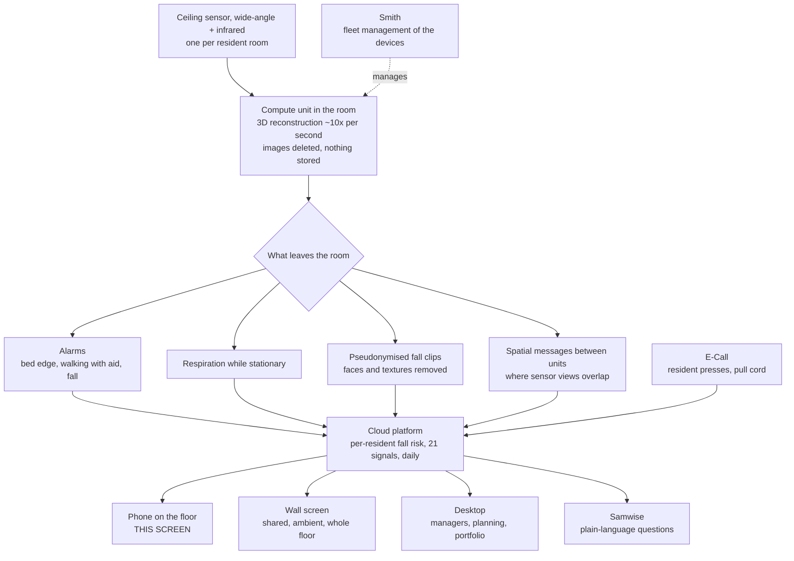

# How this screen sits in the rest of the system

> **The drawn version of this note is [`system-flow.html`](../system-flow.html)**, which traces one fall in room 05 through every piece of hardware and every screen, and marks what is published against what is proposed. The diagram below is the same structure in text.

Everything here is from Teton's public material: the engineering blog, the careers pages, and the open-source [`teton-ai/smith`](https://github.com/teton-ai/smith) repository. Where the design assumes something not published, it is marked as an assumption.

## The path from a room to a thumb

## What each surface is for, and what this screen must not do

| Surface | Who holds it | Its job | What that means here |
| --- | --- | --- | --- |
| **Phone app** | Care assistant on the floor | What to do in the next sixty seconds | This screen. No analysis, no trends, no reading |
| **Wall screen** | Everyone on the floor | Ambient state of the whole floor | Should show a room as covered the moment presence is detected, so two people do not walk to the same room |
| **Desktop** | Manager, head of care, regional | Review, planning, Predictive Intelligence | Where the hourly chart and the patterns belong. The phone folds them away |
| **Samwise** | Staff and managers | Plain-language questions | Where "why did this fire" lives. The phone card should not explain itself, Samwise should answer afterwards |
| **E-Call** | The resident | Asking for a person | A different kind of event from one the building noticed, and it should not look identical on the card |

## The three events on this screen, and where each comes from

| On the card | Source | Published? |
| --- | --- | --- |
| Possible fall, with confidence | Sensor, fall detection, pseudonymised clip available | Yes |
| Call button | E-Call | Yes, shipped September 2026 |
| Colleague needs help | Staff-to-staff assist | **No. This is a proposal** |

## Presence, and why it replaces the acknowledgement tap

Teton states that the compute unit reconstructs the room ten times a second and identifies where people are and what they are doing, and that cross-room tracking supports accurately counting staff visits. Common Areas extends the same sensors into hallways, dining rooms and lounges, and calibrates every sensor into **one coordinate frame for the whole facility**, with real-time occupancy visible in the app.

So the system can already tell that a second person has entered room 05. That is enough for:

- marking the alert **attended** with no tap from the nurse
- showing the room as covered on the wall screen and on the other phone, so nobody doubles up
- counting response time honestly, from alert to arrival, rather than from alert to whenever somebody remembered to press a button

What is **not** published, and is therefore an assumption:

- **Identity.** The material says staff are detected as people but does not explain how they are told apart from residents or visitors. The likely answer is the phone, not the ceiling: whoever is signed in and on shift, matched to the room the sensors see occupied.
- **Degrading gracefully.** Where identity is unknown, the screen should say "a colleague is in room 07" rather than nothing. That is still the fact you need.

## One design consequence worth stating

If presence is shared between the phone, the wall screen and the other staff phone, then acknowledgement stops being a personal action and becomes a shared fact about the building. That resolves a tension named in the job posting, between staff agency and leadership oversight, in the staff's favour: nobody is recording what you did, the building is recording that the resident was reached.

Sources: [How Teton Sees the Room](https://www.teton.ai/blog/how-teton-sees-the-room) · [Common Areas](https://www.teton.ai/blog/common-areas-how-teton-protects-the-whole-community) · [Samwise](https://www.teton.ai/blog/samwise-blog) · [Introducing Optimized Alerts](https://www.teton.ai/blog/introducing-optimized-alerts) · [teton-ai/smith](https://github.com/teton-ai/smith)
